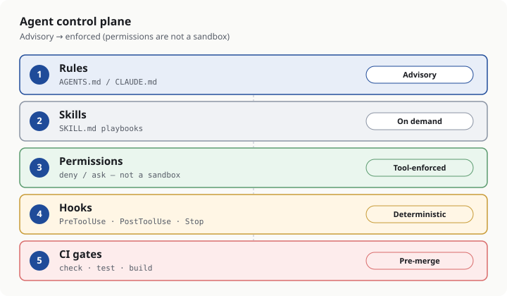

# OPC Vibe Stack

[English](README.md) · [简体中文](README.zh-CN.md)

Practical **AI coding workflows for solo builders and one-person companies**. The site is English-first and also published in Chinese: **[opcvibestack.com](https://opcvibestack.com)**.

It is unofficial practice guidance for researching, building, and selling with coding agents — not a vendor ranking, course platform, or affiliation with Anthropic, OpenAI, or xAI. The tools featured in the stack can change; the current set is listed on the [Stack](https://opcvibestack.com/en/stack/) page.

<p align="center">
  
</p>

<p align="center"><em>Editorial diagram from the <a href="https://opcvibestack.com/en/articles/rules-hooks/">rules and hooks guide</a> — not a vendor screenshot.</em></p>

## What you’ll find

- **Research, Build, and Sell stages**, each with its own entry questions, deliverables, and reading order, plus shared guides as supplementary references: [Research](https://opcvibestack.com/en/research/), [Build](https://opcvibestack.com/en/build/), [Sell](https://opcvibestack.com/en/sell/).
- **Tool guides** for the current featured agents — today [Claude Code](https://opcvibestack.com/en/articles/claude-code/), [Codex](https://opcvibestack.com/en/articles/codex/), and [Grok Build](https://opcvibestack.com/en/articles/grok-build/). See the [Stack comparison](https://opcvibestack.com/en/stack/).
- **Playbooks**, including a [48-hour MVP time budget](https://opcvibestack.com/en/articles/48h-mvp-agent-stack/) (a suggested budget, not a delivery guarantee) and a [weekly content-site refresh loop](https://opcvibestack.com/en/articles/weekly-content-site-refresh/). All playbooks: [Playbooks](https://opcvibestack.com/en/playbooks/).
- **Evidence labels** on every article — `tested` (reproduced by the editors, with date and environment), `documentation-backed` (matches official or primary vendor docs; not necessarily re-run this week), and `unverified` (source checked, not re-tested). Definitions: [About](https://opcvibestack.com/en/about/).
- **Visual guides** (self-made diagrams, not UI screenshots) alongside steps and tables. Conventions: [docs/illustrations.md](docs/illustrations.md).

## Start here

A short path through the live site:

1. Open the [homepage](https://opcvibestack.com/en/) or the [Stack comparison](https://opcvibestack.com/en/stack/).
2. Before an agent edits a repo, write the outcome and a verify command: [Spec first, then let the agent change code](https://opcvibestack.com/en/articles/spec-first-agent-loop/).
3. Put conventions and hard no-gos where the tools will actually enforce them: [Rules files + hooks](https://opcvibestack.com/en/articles/rules-hooks/).
4. If you want a timeboxed end-to-end loop, use the [48-hour MVP playbook](https://opcvibestack.com/en/articles/48h-mvp-agent-stack/) (suggested budget).
5. When a slice already works, turn it into a stranger-ready offer: [Ship & demo checklist](https://opcvibestack.com/en/articles/ship-demo-checklist/).

Chinese editions of the same pages live under [`/zh/`](https://opcvibestack.com/zh/).

## How this site is maintained with AI

The public byline is the **OPC Vibe Stack editorial team**. Drafting and revision often use AI coding agents (the same stack the guides describe). A human editor reviews sources, evidence labels, numerical claims, and the decision to publish; AI assistance does not replace that review or checking current official documentation. Details: [About](https://opcvibestack.com/en/about/#editorial).

Daily Vibe Coding briefings (English, X-first) feed a weekly editorial pass. Documentation-backed and briefing-derived changes are checked against original sources, tool versions, and evidence labels before publication. Updates are recorded in the [changelog](https://opcvibestack.com/en/changelog/).

`npm run build` runs content checks and then validates the generated site: internal links and anchors, images, self-canonical URLs, reciprocal hreflang, JSON-LD, and sitemap `lastmod` values from real update dates (not the build clock). The repo also includes an example release process that packages a verified build into a new directory and activates it with a symlink rather than overwriting a live tree (`site/ops/`).

If something is wrong, unclear, or out of date, open a GitHub issue — that is the public correction channel: [Issues](https://github.com/SS-Bot-Org/opc-vibe-stack/issues).

## Tech stack and local development

The published site is a static [Astro](https://astro.build) app in [`site/`](site/). It is bilingual (`en` / `zh`). Requires **Node.js 22.23.4 or newer** (`site/package.json`).

```bash
cd site
npm ci            # install from package-lock.json
npm run dev       # local preview
npm run check     # typecheck
npm test          # regressions
npm run build     # validate content, build, and check the output
```

## Repository layout

```
site/                  Astro app, content, tests, and build validators
  src/content/         Markdown articles and changelog (en/ and zh/)
  src/pages/           Routes, including /en/ and /zh/
  public/              Static assets, including illustrations and share images
  scripts/             Content and output validators
  ops/                 Example release and nginx snippets
docs/                  Editorial conventions (SEO/GEO, illustrations)
AGENTS.md              Repository working notes for contributors and coding agents
```

Product and design background (internal, not the public site): [PRD-v0.5.md](PRD-v0.5.md), [SDD-v0.2.md](SDD-v0.2.md).

## Contributing and corrections

- Prefer a pull request for a concrete fix or a [GitHub issue](https://github.com/SS-Bot-Org/opc-vibe-stack/issues) for a correction.
- Content and metadata should follow [docs/seo-geo.md](docs/seo-geo.md): keep official fact, editorial recommendation, and tested results distinct; do not make the Chinese text more absolute than the English; do not invent authors, dates, or metrics.
- New diagrams should follow [docs/illustrations.md](docs/illustrations.md).
- Never commit credentials, `.env` files, or generated `dist/` output.
