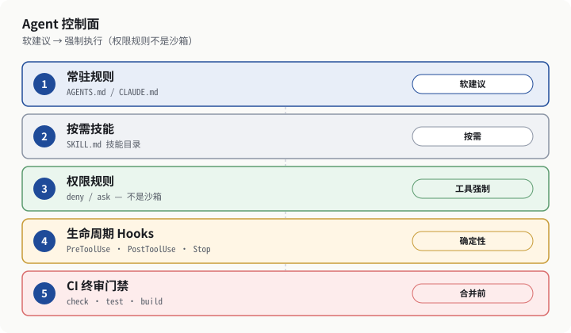

# OPC Vibe Stack

[English](README.md) · [简体中文](README.zh-CN.md)

面向**一人公司和独立开发者的 AI 编程与交付实践指南**。站点以英文为先，同时提供中文版：**[opcvibestack.com](https://opcvibestack.com)**。

这是关于用编码 agent 做调研、构建和销售的非官方实践说明，不是厂商排行榜、课程平台，也与 Anthropic、OpenAI、xAI 没有从属关系。工具栈中展示的产品可能会调整；当前列表见[工具栈](https://opcvibestack.com/zh/stack/)页。

<p align="center">
  
</p>

<p align="center"><em>插图来自<a href="https://opcvibestack.com/zh/articles/rules-hooks/">规则与 hooks 指南</a>，是编辑绘制的说明图，不是厂商界面截图。</em></p>

## 你可以在这里找到什么

- **调研、构建、销售**三个阶段，各自有入口问题、交付物和建议阅读顺序；跨阶段文章作为补充参考：[调研](https://opcvibestack.com/zh/research/)、[构建](https://opcvibestack.com/zh/build/)、[销售](https://opcvibestack.com/zh/sell/)。
- 当前主推工具的**使用指南**——目前是 [Claude Code](https://opcvibestack.com/zh/articles/claude-code/)、[Codex](https://opcvibestack.com/zh/articles/codex/) 与 [Grok Build](https://opcvibestack.com/zh/articles/grok-build/)。对照见[工具栈](https://opcvibestack.com/zh/stack/)。
- **Playbook**，包括[建议的 48 小时 MVP 时间预算](https://opcvibestack.com/zh/articles/48h-mvp-agent-stack/)（这是建议预算，不是交付承诺）和[内容站周更闭环](https://opcvibestack.com/zh/articles/weekly-content-site-refresh/)。全部列表：[Playbooks](https://opcvibestack.com/zh/playbooks/)。
- 每篇文章都有**证据标签**：`tested`（编辑已复现或等价验证，并记录日期与环境）、`documentation-backed`（与官方或主要厂商文档一致，不一定本周重跑）、`unverified`（已核对来源，但未复测）。说明见[关于](https://opcvibestack.com/zh/about/)。
- 配合步骤与表格的**图解**（自行绘制，不是界面截图）。约定见 [docs/illustrations.md](docs/illustrations.md)。

## 从这里开始

一条较短的阅读路径：

1. 打开[中文首页](https://opcvibestack.com/zh/)或[工具栈对照](https://opcvibestack.com/zh/stack/)。
2. 在 agent 改仓库之前，先写清结果和验证命令：[先写规格，再让 agent 改代码](https://opcvibestack.com/zh/articles/spec-first-agent-loop/)。
3. 把约定和硬红线放到工具真正会执行的位置：[规则文件 + hooks](https://opcvibestack.com/zh/articles/rules-hooks/)。
4. 若需要一条有时限的端到端闭环，可参考[48 小时 MVP Playbook](https://opcvibestack.com/zh/articles/48h-mvp-agent-stack/)（建议预算）。
5. 当切片已经能跑，再把它变成陌生人能看懂的供给：[上线与演示清单](https://opcvibestack.com/zh/articles/ship-demo-checklist/)。

对应英文页面在 [`/en/`](https://opcvibestack.com/en/) 下。

## 本站如何用 AI 维护

公开署名是 **OPC Vibe Stack 编辑团队**。起草和修订经常使用 AI 编码代理（也就是各指南所描述的同一套工具栈）。发布前由人工编辑核对来源、证据标签、数字主张，并决定是否上线；AI 辅助不能取代这项复核，也不能代替查阅现行官方文档。说明见[关于](https://opcvibestack.com/zh/about/#editorial)。

每日 Vibe Coding 简报（以英文、X 为先）进入每周编辑流程。以文档为依据或来自简报的变更，会在发布前核对原文、工具版本与证据标签。修订记录在[更新日志](https://opcvibestack.com/zh/changelog/)。

`npm run build` 会先做内容校验，再检查生成站点：内部链接与锚点、图片、自指 canonical、互返 hreflang、JSON-LD，以及来自真实更新日期（而不是构建时刻）的 sitemap `lastmod`。仓库里还有一套示例发布流程：把通过校验的构建放入新的目录，再用 symlink 切换生效，而不是直接覆盖正在服务的目录（见 `site/ops/`）。

若发现错误、表述不清或内容过时，请通过 GitHub Issues 提交——这是本站的公开纠错渠道：[Issues](https://github.com/SS-Bot-Org/opc-vibe-stack/issues)。

## 技术栈与本地开发

线上站点是 [`site/`](site/) 中的静态 [Astro](https://astro.build) 应用，提供 `en` / `zh` 两个语言版本。需要 **Node.js 22.23.4 或更高版本**（见 `site/package.json`）。

```bash
cd site
npm ci            # 按 package-lock.json 安装依赖
npm run dev       # 本地预览
npm run check     # 类型检查
npm test          # 回归测试
npm run build     # 校验内容、构建并检查产物
```

## 仓库结构

```
site/                  Astro 应用、内容、测试与构建校验
  src/content/         Markdown 文章与更新日志（en/ 与 zh/）
  src/pages/           路由，包括 /en/ 与 /zh/
  public/              静态资源，包括插图与分享图
  scripts/             内容与产物校验
  ops/                 示例发布流程与 nginx 片段
docs/                  编辑约定（SEO/GEO、插图）
AGENTS.md              给贡献者和编码代理的仓库说明
```

产品与设计背景（内部文档，不是公开站点正文）：[PRD-v0.5.md](PRD-v0.5.md)、[SDD-v0.2.md](SDD-v0.2.md)。

## 贡献与纠错

- 具体修正请优先提 pull request；纠错说明可开 [GitHub issue](https://github.com/SS-Bot-Org/opc-vibe-stack/issues)。
- 内容与元数据请遵循 [docs/seo-geo.md](docs/seo-geo.md)：把官方事实、编辑建议和实测结果分开写；中文不要比英文更绝对；不要编造作者、日期或数据。
- 新增图解请遵循 [docs/illustrations.md](docs/illustrations.md)。
- 不要提交凭证、`.env` 文件或生成的 `dist/` 产物。
