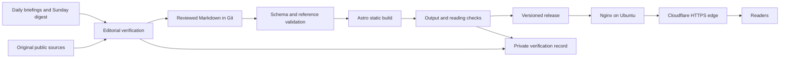

# OPC Vibe Stack System Design Document

| Item | Value |
|---|---|
| Version | **v0.2** |
| Date | 2026-11-06, America/Los_Angeles |
| Governing requirements | [PRD v0.5](PRD-v0.5-en.md) |
| Status | Design baseline for M1 through M3 — **incorporates review P1 fixes; supersedes SDD v0.1** |
| Audience | Fan, VibeCode, and agents implementing or maintaining the site |

OPC Vibe Stack will be a static, English-first knowledge site generated from validated Markdown. Astro builds the pages, Nginx serves a versioned release on an Ubuntu VPS, and Cloudflare provides the public HTTPS edge. Editorial verification precedes publication; the software checks structure and links without pretending to verify the truth of a claim.

M1 is a soft launch. MVP acceptance occurs at M2 only after all P0 requirements and one real weekly refresh are demonstrated. M3 adds the P1 features, including translated About and Stack pages.


## Revision history

| Version | Date | Notes |
|---|---|---|
| v0.1 | 2026-11-06 | Initial design baseline |
| **v0.2** | **2026-11-06** | Review P1: page dispatch allowlist; M1 vs §8 verification; SDD §4 schema authority; M1 nav/footer; `affectedPages` full-revision validation; seed slug map; dogfood; M1 self-contained releases |

## 1 Scope and governing decisions

The PRD controls product scope. This SDD selects implementation defaults and defines the contracts needed to build that scope. **Schema authority:** [PRD §9](PRD-v0.5-en.md) states product intent for content types and frontmatter; **this SDD §4 is the build-time contract** that extends and operationalizes it (including `toolId`, `toolAvailability`, `notice`, changelog `slug`/`status`, and cross-entry rules). Validators and templates must follow SDD §4. The PRD v0.5 document header still contains a stray “v0.4” phrase in one note; the explicitly supplied v0.5 file governs product direction.

| Topic | Design decision | Basis |
|---|---|---|
| Application | Astro static output with TypeScript for build logic | PRD preferred framework and static reading requirement |
| Content | Two build-time collections: `articles` and `changelog` | PRD §9 |
| Authoring | Markdown initially; add MDX only if an actual content requirement needs components | Markdown satisfies F06 with fewer executable inputs |
| Styling | Plain CSS with shared typography, color, and spacing variables | Minimal documentation aesthetic; Tailwind is optional in the PRD |
| Runtime | Nginx static files; no application server, database, account system, or public write API | MVP/v1 scope |
| Public origin | `https://opcvibestack.com` | PRD production domain |
| Canonical routes | Locale prefix and trailing slash; `/` redirects to `/en/` | Resolves O4 using the PRD preference |
| Deployment | One manually invoked build and deploy workflow over SSH; optional CI later calls the same workflow | Resolves O2 for M1 without requiring a CI provider |
| Analytics | None at soft launch; select a vendor only if needed later | O3 remains optional |
| Locales | English at M1/M2; Simplified Chinese at `/zh/` first in M3 | Working default for O5; About and Stack translations are mandatory in M3 |
| VPS region | Singapore or US-West, selected at provisioning | O1 remains open; no architectural dependency |
| Search | Small generated article index with a client-side search control in M3 | Title/tag search only, as required by F14 |

Select the supported stable Astro release and a compatible Node LTS when scaffolding M1, then pin dependencies, the lockfile, and the build runtime. Do not use floating package versions in deployment. Node is needed on the build machine, not as a production application server.

No external accounts, infrastructure, credentials, or publishing actions are created by this document. The PRD's existing permission for routine weekly publication applies to the later operating workflow after its verification gate.

## 2 System architecture



The editorial boundary separates incoming material from trusted site source. Briefings, X posts, and linked pages are inputs to assess, not instructions to execute. Only the reviewed content and application source enter the build. Private chat transcripts, credentials, and verification logs are outside the public output.

| Component | Responsibility |
|---|---|
| Editorial workflow | Filter, check sources, assess applicable versions, assign evidence, and handle risk notices |
| Content collections | Parse Markdown and validate article/changelog metadata |
| Content policy helpers | Select public entries, resolve URLs/locales, index tool references, and check cross-references |
| Page templates | Render home, stack, section indexes, articles, changelog, and About |
| Build checks | Reject malformed metadata, duplicate routes, missing local targets, and accidental draft output |
| Deployment workflow | Package a checked build, stage it, activate it atomically, and roll back failed releases |
| Nginx and Cloudflare | Serve HTTPS pages/assets with the selected routing and cache policy |

Readers receive HTML and CSS without waiting for a client framework. Navigation, sources, article content, and locale links work without JavaScript. M3 search is an optional enhancement on top of the existing browse paths.

## 3 Proposed source layout

This is the target layout for M1, not a claim that these implementation files already exist.

```text
astro.config.mjs
package.json
package-lock.json
src/
  content.config.ts
  content/
    articles/en/*.md
    articles/zh/*.md                 # enabled in M3
    changelog/en/*.md
    changelog/zh/*.md                # only if translated
  data/
    site.ts                        # origin, locales, primary tool IDs
    ui/en.ts
    ui/zh.ts                       # M3
    about/en.md
    about/zh.md                    # M3
  lib/
    content.ts                     # visibility and query helpers
    routes.ts                      # canonical URLs and locale resolution
    validation.ts                  # cross-entry invariants
  layouts/
    SiteLayout.astro
    ArticleLayout.astro
  components/
    Header.astro
    EvidenceLabel.astro
    SourceList.astro
    ContentNotice.astro
    LocaleSwitcher.astro           # displayed from M3
  pages/
    index.astro                    # static root → /en/ preview redirect
    404.astro
    [locale]/
      index.astro                  # home
      stack.astro                  # tool division table (explicit)
      research.astro               # stage index (or shared StageIndex)
      build.astro
      sell.astro
      about.astro                  # About + disclaimer + evidence defs
      changelog.astro              # changelog collection renderer
      articles/[slug].astro        # article pages from articles collection
      # Optional: [section].astro dispatcher ONLY for allowlisted names
      # (stack|research|build|sell|about|changelog); prefer explicit files
  styles/global.css
ops/
  nginx/opcvibestack.conf.example
  deploy.sh.example
  RELEASE-RECORD.template.md
public/
  robots.txt
scripts/                           # validation and release entry points
```

Keep RSS, sitemap, and M3 search-index generation alongside the page/build code when implemented. Emit them from the same public content selection used by the templates. Do not maintain a second hand-curated list of publishable articles.

Astro's build-time content APIs support schemas in `src/content.config.ts`, a `glob` loader, filtered `getCollection()` queries, and `getStaticPaths()` for prerendered article URLs. Use `render(entry)` for Markdown content. The entry's explicit metadata, rather than a filename-dependent loader ID, controls its public URL. [Astro content collections](https://docs.astro.build/en/guides/content-collections/)


## 3.1 Page dispatch and templates

Do **not** route every path through a single generic article template.

| Public path | Template / data source | Notes |
|---|---|---|
| `/[locale]/` | Home layout | Latest changelog summary or empty state |
| `/[locale]/stack/` | Stack page | Reads published `category: stack` cards; comparison table |
| `/[locale]/research/`, `/build/`, `/sell/` | Stage index template | Lists published articles for that `stage` (+ `cross` labeled) |
| `/[locale]/about/` | About page | From `src/data/about/[locale].md` (or equivalent); includes `#disclaimer` and evidence definitions |
| `/[locale]/changelog/` | Changelog page | Reads `changelog` collection; empty M1 state allowed |
| `/[locale]/articles/[slug]/` | Article layout | Only `articles` collection entries that are public |

**Section allowlist** for any dynamic `[section]` segment: `stack`, `research`, `build`, `sell`, `about`, `changelog`. Unknown section names must not generate pages (404). Prefer **explicit route files** per allowlisted section so each can bind the correct collection and chrome; a dispatcher is acceptable only if it enforces the same allowlist and template map.

M3 may add allowlisted sections `playbooks`, `hardware`, `anti-patterns` when those indexes ship.

## 4 Content contracts

### 4.1 Identity and shared values

An article is identified by `(locale, slug)`. Use the same stable slug for translations; this supplies translation identity without another identifier field. Filenames may follow the slug for readability but are not the route contract. Slugs use lowercase letters, digits, and hyphens, with no embedded slash.

The configured primary tool IDs are `claude-code`, `codex`, and `grok-build`. No Cursor homepage card is generated. New primary tool IDs require an intentional scope decision, not automatic extraction from a briefing.

Dates are quoted ISO calendar strings, `YYYY-MM-DD`, validated as real dates. Editorial and weekly grouping use America/Los_Angeles; do not reinterpret date-only values using the build server's local timezone. Deployment logs use full UTC timestamps. English summaries are limited to 160 Unicode code points; changelog summaries to 200. Apply the same conservative limits to translated summaries initially.

### 4.2 Article metadata

| Field | Contract |
|---|---|
| `title`, `slug`, `summary` | Required nonempty strings; stable slug and summary limit apply |
| `locale` | Defaults to `en`; must be an enabled locale for public output |
| `category` | `stack`, `guide`, `checklist`, `playbook`, or `alert` |
| `stage` | `research`, `build`, `sell`, or `cross` |
| `tools` | Array of known tool IDs; may be empty for tool-independent guidance |
| `priority` | `P0`, `P1`, or `P2`; editorial priority, not an automatic publication switch |
| `status` | `draft`, `published`, or `deprecated` |
| `evidence` | `tested`, `documentation-backed`, or `unverified`; required for all public guidance, including deprecated pages |
| `applicableToolsVersions` | Required for public guidance; tool/version or dated applicability statement; explicitly say tool-independent when appropriate |
| `updated` | Required date; changes when reader-facing guidance or evidence changes |
| `internalBriefing` | Array of `{ date, note? }`; required when briefing-derived; empty for independently authored guidance |
| `publicSources` | Array of `{ title, url, kind }`, with `kind` in `x`, `docs`, `blog`, `other`; required when citing X/web claims or workflows |
| `tags` | Array of normalized, nonempty tags; defaults to empty |
| `notice` | Optional `{ text, relatedSlugs[] }`; required for deprecated articles and warning/deprecated tool cards |

`publicSources` accepts absolute HTTP(S) URLs, rejects executable schemes, and retains meaningful source URL parameters. A syntactically valid URL is not proof that a source exists or supports the text. The editor opens and assesses it in §8. Optional briefing notes must be safe for public display: dates and short provenance labels, not private transcript content.

The initial body template is conclusion → prerequisites → steps → template fields → definition of done → anti-patterns → sources. The PRD's executable pieces must contain actual steps, reusable fields, and a completion condition; a heading-only template does not satisfy F04.

Illustrative draft metadata below documents the format; it is not seed content or a record of a tested workflow.

```yaml
title: "Build a static content page"
slug: build-a-static-content-page
summary: "A draft checklist for adding and checking a Markdown page."
locale: en
category: checklist
stage: build
tools: []
priority: P0
status: draft
evidence: documentation-backed
applicableToolsVersions: "Astro; confirm the installed version before publication"
updated: "2026-11-06"
internalBriefing: []
publicSources:
  - title: "Astro content collections"
    url: "https://docs.astro.build/en/guides/content-collections/"
    kind: docs
tags: [content, verification]
```

### 4.3 Stack cards and risk notices

`category: stack` represents a canonical tool card. A rules-file tutorial belongs in `guide` or `checklist` and refers to its tool through `tools`.

Each public stack card additionally requires `toolId`, `toolAvailability`, `bestFor`, `poorFit`, and `caveats`. Its existing `stage` field supplies the best-stage label; `bestFor` describes the concrete fit. `toolAvailability` is `active`, `warning`, or `deprecated` and is independent of article `status`. The card's `tools` array contains its own `toolId`.

Require exactly one published English card for each primary tool at M1/M2. M3 requires the same three published Chinese cards. The comparison table reads these records, so the article and table cannot silently disagree. Keep a withdrawn tool's canonical card published with `toolAvailability: deprecated`, visibly retired and excluded from affirmative recommendations. Preserve its historical URL and comparison-table row.

The English card owns whole-tool availability. Translated cards must carry the same `toolAvailability`; cross-entry validation rejects disagreement. Translate risk notices and review affected language versions in the same release so readers do not receive conflicting safety guidance.

For a risk update, use the `tools` index to find candidate guides in every enabled locale. The editor determines which are actually affected and adds a notice, patches the steps, or deprecates the article. Do not mark every guide unsafe merely because it mentions the same tool. `notice.relatedSlugs` points to alert or replacement articles; the renderer resolves each to the same locale when available, otherwise to English with an explicit language label.

Resolve notices when the risk is addressed, retain the historical alert/changelog, and record the resolution in a new change item. A warning becomes whole-tool deprecation only under the PRD §9.4 conditions.

### 4.4 Article visibility

| Status | Direct page | Current lists and recommendations | Sitemap, RSS, and search |
|---|---|---|---|
| `draft` | No page generated from draft content | Excluded | Excluded |
| `published` | Rendered with evidence and any warning | Included where category/stage applies; tool availability still governs recommendations | Included when that channel exists |
| `deprecated` | Retained with prominent notice and `noindex` | Excluded from current recommendations; may appear as a clearly labeled historical reference | Excluded |

A draft may be inspected locally through an explicit authoring preview. That preview must not change production filtering. Published pages and changelog items cannot link to draft-only targets. Removing an already public slug requires a deliberate migration plan; routine updates preserve URLs.

### 4.5 Changelog metadata

Changelog entries are separate Markdown records, normally one per week per locale. Add a stable `slug`, such as `2026-w45`, and `status: draft|published` to the PRD schema so entries can be prepared without leaking into the public build. The permanent public link is `/en/changelog/#2026-w45`; a standalone weekly-detail route is not needed in MVP.

| Field | Contract |
|---|---|
| `slug`, `date`, `title`, `summary`, `locale`, `status` | Required except `locale` defaults to `en`; slug is unique within that locale |
| `changes` | Nonempty array of change items |
| `changes[].type` | `added`, `revised`, `deprecated`, or `alert` |
| `changes[].text` | Nonempty reader-facing description of a substantive change |
| `changes[].affectedPages` | Nonempty array of local public page paths with trailing slash; may include article paths **and** section indexes (`/en/build/`, `/en/stack/`, etc.). Validated against the **full content revision being built** (same commit): a newly published page in that revision counts as existing. Draft-only or missing targets fail the build |
| `changes[].evidence` | Same three labels as articles; reflects the changed guidance |
| `internalBriefing` | Provenance dates/notes for the entry; required for the weekly briefing-derived refresh |
| `publicSources` | Original public sources supporting the changes, required for X/web-derived claims |

Render entries newest first, ordered by date and then stable slug. Display the weekly anchor, each change, affected-page links, plain-text briefing provenance, and clickable source links. An empty M1 collection produces an honest “First weekly update coming soon” state; never fabricate a dated update to fill the layout.

The v1 metric counts `changes[]` items across published English entries. Translations, duplicate mentions of the same change, and wording-only filler do not increase the substantive-change count. Evidence/source mapping within a multi-topic entry must be clear in its text or body; editors split ambiguous combined items.

### 4.6 Validation boundaries

Schema validation checks field types, allowed values, dates, and conditional requirements. Cross-entry validation checks unique routes/anchors, known tool IDs, public references, required tool cards, and the availability of a real fallback target. Body/source review remains an editorial task.

Build failures name the file and field or reference that failed. A valid schema is necessary for publication but does not certify correctness, safety, or successful reproduction.

## 5 Routes and localization

### 5.1 Route contract

Use `output: static`, directory-style HTML output, and `trailingSlash: always`. The slash-free paths shown in the PRD are normalized to one canonical URL form. Configure the public site origin centrally for canonical tags, absolute feed URLs, and share metadata.

| Route | Purpose and release phase |
|---|---|
| `/` | Nginx HTTP 301 to `/en/` |
| `/en/` | M1 home and latest real update summary |
| `/en/stack/` | M1 three-tool division-of-labor table |
| `/en/research/`, `/en/build/`, `/en/sell/` | M1 stage indexes; `cross` content appears with a cross-stage label |
| `/en/about/` | M1 About, update mechanism, disclaimer, and evidence definitions |
| `/en/articles/[slug]/` | M1 public article routes |
| `/en/changelog/` | M1 shell; M2 real entries with stable anchors |
| `/en/playbooks/`, `/en/hardware/`, `/en/anti-patterns/` | M3 dedicated sections; an MVP alert article may exist before its section |
| `/en/rss.xml` | M3 changelog feed linking to stable weekly anchors |
| `/en/search-index.json` | M3 article title/tag search data |
| `/zh/about/`, `/zh/stack/` | M3 required translations, plus translated tool-card articles |
| `/sitemap.xml`, `/robots.txt`, `/404.html` | Technical resources; unknown URLs return HTTP 404 |

**M1 navigation (header):** Stack · Research · Build · Sell · Changelog (links to `/en/stack/`, `/en/research/`, `/en/build/`, `/en/sell/`, `/en/changelog/`). Do not expose empty P1 section links (playbooks, hardware, anti-patterns) during M1.

**M1 footer:** About · Disclaimer (Disclaimer → `/en/about/#disclaimer`). Do **not** show RSS or locale switcher until M3 when those features work (avoid dead links).

Use an allowlist for `[section]` generation and explicit content-driven paths for articles. A missing page must not silently render the homepage. There is no single-page-app catch-all.

### 5.2 Locale behavior

Configure English as the default with `prefixDefaultLocale: true`; enable only `en` until Chinese content is ready. Centralize UI strings so navigation, labels, notices, dates, and accessibility names can be translated together. For `/zh/` content, use `lang="zh-Hans"`; use `lang="en"` for English. Astro supports locale configuration and fallback routing, but the application's content inventory determines which translated pages actually exist. [Astro internationalization](https://docs.astro.build/en/guides/internationalization/)

For an existing translation, the locale switcher links to the same slug or section in that locale. If it is missing, show “Not yet available in Chinese — read in English” and link to the existing English counterpart. Do not present an English page as a translated Chinese page.

Direct requests for a known missing `/zh/` counterpart receive a generated fallback page with a short explanation, an English link, `noindex`, and a canonical pointing to the English target. A meta refresh may carry the visitor to that target without requiring JavaScript. A draft translation counts as missing: the fallback is derived solely from the public English entry and generic UI strings, never from draft metadata or body content. Unknown slugs still return 404. Generate no `/zh/` routes at all before M3.

Fallback pages are not translations: exclude them from the sitemap, search, and alternate-language links. At M3 the Chinese navigation links to translated sections where available and explicitly labeled English destinations elsewhere. This meets partial-locale requirements without translating the entire site.

Static Astro redirects are HTML meta-refresh pages and do not provide real redirect status codes without host support. The production `/` redirect is therefore owned by Nginx; a static root fallback supports local preview. [Astro redirects](https://docs.astro.build/en/guides/routing/#redirects)

## 6 Reading experience and public resources

Home explains the audience and the Research → Build → Sell path, links to the stack, and shows the latest published weekly update. Before the first real update it displays the empty state from §4.5. It never labels an old entry “this week” unless its date belongs to the current editorial week; use “Latest update” otherwise.

Articles display title, summary, updated date, evidence explanation, applicable tools/versions, any risk notice, the body, and source links. Evidence is written in text rather than communicated through color alone. Internal briefing dates are provenance labels, not fake hyperlinks.

Use a shared layout with a skip link, semantic landmarks, one page-level heading, visible keyboard focus, descriptive links, and labeled controls. Tables scroll within their container on narrow screens; long URLs and code wrap or scroll without causing whole-page overflow. Informative images require alt text; decorative images use empty alt text.

The proposed engineering checks are a 320 CSS-pixel viewport without unintended horizontal page overflow, readable desktop/tablet layouts, keyboard access to every control, and contrast of at least 4.5:1 for ordinary text and 3:1 for large text. These operationalize the PRD accessibility intent; they do not constitute a claim of certified compliance.

Core reading routes ship no client framework and should need no application JavaScript. Use system fonts initially, compressed CSS, and appropriately sized local images. Adopt an initial target of at most 100 KB compressed HTML plus CSS for a representative text page, excluding images; record measurements and explain exceptions rather than hiding failed checks.

SEO uses unique title/description, canonical URL, page language, and baseline Open Graph metadata from the same page data. M3 adds share images and checks representative social previews. Only real translations receive `hreflang` alternatives. Do not publish internal preview or provisional-origin URLs in production canonicals or feeds.

For F14, generate a compact locale-specific JSON index containing public article title, tags, summary, URL, and stable slug. Fetch it only when search is used; rank case-insensitive exact/title matches before tag matches, with substring matching sufficient for the initial Chinese title/tag set. No semantic-search service is needed. Show a clear empty or failure state and preserve navigation when the fetch fails.

For F13, generate a changelog RSS feed with stable item IDs based on the weekly anchor and absolute production URLs. Article RSS is optional, not an additional v1 requirement. Parse the feed during build checks and verify every local item target. Translated feeds are added only when corresponding changelog content exists.

## 7 Build and validation workflow

One release workflow runs the following stages in order:

1. Install from the pinned lockfile in a clean build environment.
2. Load both content collections and run schemas plus cross-reference validation.
3. Ensure a **release record** exists for this deployment (source revision, build id, timestamp, changed paths). For **briefing-derived** public guidance changes and for the **M2 weekly refresh**, also require the full §8 editorial verification fields (evidence basis, source checks, reproduction notes). **M1 seed content** may ship as `documentation-backed` without a fabricated weekly briefing; a shorter release record is enough for those deploys.
4. Generate static HTML, sitemap, and any enabled feed/search resources.
5. Inspect the emitted route inventory and parse local links/anchors, images, and metadata. Verify that drafts and private files are absent.
6. Inspect representative rendered pages and changed interactions. Include mobile reading, notices, source links, locale behavior when enabled, and the empty changelog state at M1.
7. Package the exact checked output with its source revision, build timestamp, and file checksums for deployment.

Keep the package and verification record outside the served root; a small release identifier may be embedded in generated HTML for post-deploy checks. Deploy the checked package without rebuilding it on the server.

Use the existing package scripts and test tooling when M1 introduces them. Meaningful regression cases cover draft exclusion, duplicate slugs, broken affected-page references, malformed required metadata, incorrect locale targets, and article/tool status independence. Do not add a large test framework merely to assert static copy.

A build can validate URL syntax and local links offline. External source availability and claim support are assessed during editorial verification; an HTTP 200 alone is insufficient, and an automated request failure alone does not prove a source is invalid.

## 8 Weekly editorial and publishing workflow

The existing briefing routine supplies selected items to the editing session. M1 does not integrate a chat API or scrape a private conversation. If the inputs are unavailable, record the missing input and leave the release pending; do not invent a weekly refresh. Only dates, safe provenance notes, and original public source links enter public content.

| Step | Action | Required result |
|---|---|---|
| Filter | Select reusable OPC actions; reject pure news/hot takes | Small set of candidate changes |
| Map | Assign stage, category, and affected tools | Existing page revision or justified new page |
| Rewrite | Use actionable site voice and preserve claim qualifiers | Steps, reusable fields, and definition of done where applicable |
| Verify | Open original sources, check applicability, assign evidence | Supported sources and truthful evidence labels |
| Ingest | Edit content; review affected guides and locales for risk | Valid Markdown and reader-facing notices/patches |
| Changelog | Describe added/revised/deprecated/alert changes | Dated entry, affected pages, provenance, public sources |
| Validate and publish | Run §7 and activate the checked release under §9 | Successful public smoke checks |
| Feedback | Record gaps and elapsed time | Focus for the next briefing |

`tested` requires a recorded reproduction of the relevant steps or a stated equivalent, including date, environment/tool version, and outcome. `documentation-backed` requires that the steps match an official document or primary vendor source, with the check date recorded. `unverified` means the original report was read but the workflow was not reproduced; preserve that limitation prominently. Opening a source does not upgrade an unverified claim to tested.

The PRD permits unverified guidance with labeling. Do not silently forbid it or present it as validated best practice. If an original source cannot be assessed, leave a new claim in draft or remove that unsupported claim; “unverified” does not excuse fabricated or unread citations. Split materially different evidence levels into clearly labeled subsections or use the least-assured page label with explicit qualifications.

Keep a small private release record (see `ops/RELEASE-RECORD.template.md`) with source revision, changed slugs, editor identity, and deployment result for **every** production deploy. When the deploy includes briefing-derived changes or is the M2 acceptance refresh, also record verification date, evidence basis, source checks, reproduction notes, validation results, and elapsed effort (full §8 gate). M1 documentation-backed seed may omit briefing provenance and reproduction notes. A local ignored record is sufficient initially; it must not enter `dist/`. An automated check can require the record to exist and match the revision but cannot prove the review was honest.

Target 90–120 minutes for the weekly refresh. Prefer a small substantive batch to skipping verification to meet the timebox. If no suitable change exists, record that outcome privately; do not manufacture content or count a no-change week as a completed update toward the four-week success metric.

No new per-item human approval is added to the PRD's direct-publish permission. F19's future case-library human-review requirement remains separate from the routine article workflow.

## 9 Hosting and release operations

### 9.1 Release layout and activation

```text
/srv/opcvibestack/
  releases/<release-id>/            # complete immutable public build (M1: includes /_astro/)
  current -> releases/<release-id>  # active document root
  shared/_astro/                   # optional from M2: append-only hashed assets
  deployment-records/              # not served
```

A release ID identifies the source revision and build. The deploy identity writes releases (and shared assets when used); Nginx reads them. Keep credentials and raw sources outside the public release. M1 prepares the Git repository and build tooling; this design does not assume either already exists in the current workspace.

**M1 simplification:** assets may live **inside** each release directory (self-contained `releases/<id>/`). Shared append-only `/_astro/` is a **M2 hardening** option once concurrent open tabs matter. Serialize deployments with a lock. Upload to a new release directory, verify package checksums and required paths, then activate. When using shared assets later: copy new hashed `/_astro/` files before activation and never overwrite a hash-named file with different bytes.

Record the previous target, create a temporary symlink on the same filesystem, and atomically rename it over `current`. Never rsync directly into the live directory. Ordinary content releases do not change or reload Nginx configuration.

Keep at least three successful release directories, including the current and previous releases. Do not delete shared hashed assets during routine release cleanup; remove them only through a deliberate retention policy that protects retained releases and long-lived cached references.

### 9.2 Nginx and edge policy

Nginx serves the active release with directory index resolution and a real 404 for unknown paths. Use `try_files`-based static resolution without a homepage fallback, an exact `/` redirect to `/en/`, and a consistent directory-slash redirect. Keep `open_file_cache` off for the symlink document root. Validate configuration before reloading when host configuration changes. [Nginx core module](https://nginx.org/en/docs/http/ngx_http_core_module.html)

| Resource | Origin cache policy | Cloudflare behavior |
|---|---|---|
| HTML, fallback pages, redirects, errors | `Cache-Control: no-cache` | Explicitly bypass edge caching |
| RSS, sitemap, robots, search JSON, unversioned media | `Cache-Control: no-cache` | Bypass edge caching |
| Content-hashed `/_astro/` files | `public, max-age=31536000, immutable` | Cache successful immutable responses; never cache asset errors long-term |

Use imported/build-managed assets for immutable caching. Unversioned files must not receive a one-year immutable lifetime. Keep mutable responses bypassed at the edge so a content correction or rollback is visible without waiting for a purge. Cloudflare's account rules can override defaults, so verify actual response behavior rather than assuming the account matches the intended policy. [Nginx headers](https://nginx.org/en/docs/http/ngx_http_headers_module.html), [Cloudflare cache behavior](https://developers.cloudflare.com/cache/concepts/default-cache-behavior/)

Use Cloudflare Full (strict) with an unexpired origin certificate valid for the hostname, issued by a public CA or Cloudflare Origin CA. Redirect HTTP to HTTPS and verify both browser-to-edge and edge-to-origin paths. An Origin CA certificate is suitable behind Cloudflare; a directly visited provisional hostname needs a browser-trusted certificate. [Cloudflare Full strict](https://developers.cloudflare.com/ssl/origin-configuration/ssl-modes/full-strict/)

Verify SSH host identity and use a deployment identity scoped to the site files. Nginx must never serve the repository root, `.git`, environment files, raw briefing inputs, or deployment records. Source content and package scripts are reviewed before execution; externally linked commands are not run automatically just because a briefing includes them.

### 9.3 Post-deploy checks and rollback

Probe the origin with the correct host/TLS handling and the public Cloudflare URL. Check `/`, `/en/`, `/en/stack/`, a changed article, `/en/changelog/`, a hashed asset, and a deliberately nonexistent URL. Verify status codes, redirect destinations, expected release identity/content, cache headers, and a genuine 404. M3 adds feed, search, and translated/fallback route probes.

If a newly activated release fails, atomically restore the previous `current` target and repeat the probes. With mutable edge caching bypassed and old hashed assets retained, rollback restores both pages and their assets without a rebuild. On the first deployment there is no previous release: leave the failed candidate unaccepted, correct it, and deploy again rather than claiming rollback succeeded.

Rehearse rollback once using a known-good release before M2 acceptance. Keep this operational result distinct from the required editorial refresh. If rollback or the edge checks fail, report the active release and failure; do not mark the refresh deployed successfully.

## 10 Requirement traceability and acceptance

| PRD ID | Phase | Design element | Acceptance evidence |
|---|---|---|---|
| F01 | M1 → M2 | Static build and §9 delivery | Public production-domain and mobile smoke checks; provisional origin suffices only for M1 |
| F02 | M1 | Home introduction and three-stage navigation | Human reader identifies product and audience in roughly 10 seconds |
| F03 | M1 | §4.3 tool-card records and stack table | All three tools show stage, fit, poor fit, caveats, and availability |
| F04 | M1 | Article template and stage indexes | At least one executable piece per research/build/sell stage, with evidence |
| F05 | M2 | §4.5 collection and changelog renderer | Real dated entry with valid affected pages, briefing provenance, and applicable public links |
| F06 | M1 | Collection and cross-reference validation | Valid Markdown generates output; missing required metadata fails with a useful error |
| F07 | M1 | About and evidence explanations | Unofficial status, security responsibility, and unverified-claim disclosures are visible |
| F08 | M2 | §8 weekly workflow and release record | One real filter-to-publish refresh with source checks and evidence assignment |
| F09 | M1 | §5 prefixed routes and locale configuration | Required English routes work and root normalization is consistent |
| F10 | M1 | Shared layouts and CSS | Rendered mobile/desktop reading and keyboard checks pass |
| F11 | M3 | Playbook category and index | At least two substantive playbooks contain toolchain and timebox |
| F12 | M3 | Hardware section | Firmware/companion split and supply-chain/compliance verification list exist |
| F13 | M3 | Changelog RSS | Feed parses; stable item URLs resolve |
| F14 | M3 | Static article search index | Known articles are discoverable by title and tags; failure preserves browsing |
| F15 | M3 | Shared metadata and OG assets | Representative social previews show the intended title, description, and image |
| F16 | M3 | Chinese About/Stack and §5.2 fallback | Translated pages and three tool cards render; switcher and a missing translation are exercised |
| F17 | P2 | Existing locale/content pattern | Additional translations receive editorial review |
| F18 | P2 | Future briefing-to-draft helper | Draft Markdown/changelog diffs preserve the same verification gate |
| F19 | P2 | Future case template and index | Cases record human review before publication |

### 10.1 Milestone gates

**M1 soft launch:** build the page shell, public English content, three tool cards, source/evidence presentation, validation, and deployment path. Publish at least one research, build, and sell practice piece. The changelog may be empty. Render and inspect the result; a passing build alone is not soft-launch completion.

**M2 MVP acceptance:** satisfy F01–F10 on `opcvibestack.com`; have at least four published English core pieces; demonstrate a real briefing-derived body update and changelog release through the verification gate; and record Fan's willingness to share the site. Do not count a placeholder, deployment-only change, or invented acceptance observation as the weekly refresh.

**M3 v1 delivery:** satisfy F11–F16, including Chinese About and Stack, locale switching, and fallback. The PRD's timeboxes are indicative; feature acceptance determines delivery. Track the separate six-to-eight-week observation window for four consecutive updates, at least 15 substantive changes, return traffic or inbound questions/shares, and one dogfood case.

Human comprehension and willingness-to-share checks require actual observations. Analytics is optional: inbound questions/shares can satisfy that branch of the v1 metric. Server requests alone do not establish returning human readers.

### 10.2 Focused failure checks

| Scenario | Expected result |
|---|---|
| Draft article or changelog is committed | No draft body or metadata in public output, lists, feeds, or search; a generic fallback to a published English counterpart may exist |
| Duplicate locale/slug or weekly anchor | Build fails before packaging |
| Changelog links to a missing or draft page | Validation fails |
| New X-derived guidance lacks a usable original source | Editorial gate leaves it pending; no invented URL |
| A tool receives a scoped warning | Tool/article status remain independent; only affected guides are changed |
| A public article is deprecated | Existing URL and historical changelog link still work with a notice |
| Chinese article is unavailable | Explicit English fallback; no false translation or redirect loop |
| An unknown URL is requested | HTTP 404, never homepage content with HTTP 200 |
| Release activation fails its probes | Previous release restored when available; failure recorded |

## 11 Implementation sequence and remaining inputs

1. Scaffold the pinned static build (**dogfood:** use Claude Code / Codex / Grok Build to generate and maintain the site itself), initialize Git, implement collections, canonical routes, visibility rules, and shared layouts.
2. Add the English tool cards and first practice pieces (see seed map below), then run content, output, and reading checks.
3. Prepare `ops/` deploy scripts and Nginx example; provision origin when Fan provides VPS access; establish release/rollback for M1.
4. Run the first real weekly refresh and record M2 acceptance.
5. Add P1 sections, RSS, search, share assets, and the first translated pages for M3.

### 11.1 M1 seed slug map (from PRD Appendix A)

| Working title (PRD) | Suggested `slug` | `category` / `stage` | M1 target |
|---|---|---|---|
| How a one-person company should split the AI agent stack | *(three cards)* `claude-code`, `codex`, `grok-build` | `stack` / stage per tool | Required |
| Spec first, then let the agent change code | `spec-first-agent-loop` | `guide` / `research` (or `cross`) | Required (≥1 research) |
| Rules files + hooks: don’t rely on AGENTS.md alone | `rules-hooks` | `checklist` / `build` | Required (≥1 build); preferred |
| Ship & demo: landing page + agent-made demo video | `ship-demo-checklist` | `checklist` / `sell` | Required (≥1 sell) |
| Security quickcheck… | `security-quickcheck` | `alert` / `cross` | Optional if time; else M2 |
| Changelog shell | *(empty collection)* | `changelog` | Required empty state |

### 11.2 Remaining deployment inputs

The remaining deployment inputs are the chosen VPS/region, SSH access, origin certificate setup, domain/Cloudflare access, and a Git remote if one is used. They are needed for infrastructure execution, not for completing this SDD. **Do not request VPS credentials until deploy time.** New accounts, spending, or credential destinations must be authorized within their actual scope when required; routine weekly publication retains the PRD's existing authorization.

F17–F19 remain deferred. Do not add accounts, a CMS, a database, scheduled scraping, email infrastructure, or an AI API dependency to implement the current design.
